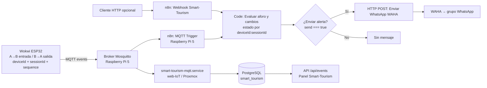
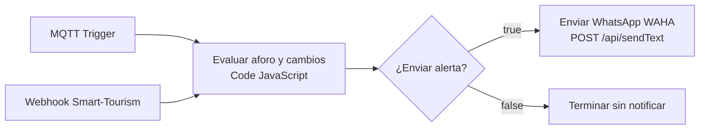

# Flujo de alertas Smart-Tourism: Wokwi → MQTT → n8n → WAHA

**Estado verificado (3 de noviembre de 2026):** varios simuladores Wokwi enviaron notificaciones a un grupo de WhatsApp indicando `sessionId` y `deviceId`. Se observaron avisos de 80 %, capacidad máxima y `REVISAR_DATOS`. No se ha demostrado aún una prueba de estrés concurrente ni la supresión de duplicados de extremo a extremo.

## Diagrama de arquitectura



El **broker de este laboratorio** está en la Raspberry Pi 5. El panel y el consumidor persistente están en el contenedor `web-IoT`; n8n y WAHA están en la Raspberry. El tópico del firmware y los consumidores debe coincidir, por ejemplo `smart-tourism/taulabe/6ae93b438bcc8191/events`. No se debe confundir esta topología de laboratorio con el valor público de ejemplo `broker.emqx.io` que aparece en las plantillas de desarrollo: ajustar las variables de entorno y el firmware al broker realmente utilizado.

## Diagrama interno de n8n (5 nodos)



Archivo de ejemplo para importar: [`n8n/smart-tourism-alertas-waha.json`](../n8n/smart-tourism-alertas-waha.json). Se distribuye **desactivado y sin credenciales reales**. Configurar credenciales MQTT, URL/clave WAHA y grupo WhatsApp en n8n antes de activarlo. La expresión del campo `text` de WAHA debe utilizar `$json.message`.

### Contrato de evento

Ejemplo sintético, sin datos personales:

```json
{
  "deviceId": "ACCESO-01",
  "sessionId": "SIM-A",
  "sequence": 3,
  "eventId": "ACCESO-01-SIM-A-000003",
  "occupancy": 8,
  "capacity": 10,
  "validation": "ACEPTADO",
  "reason": "A_B",
  "alert": "ADVERTENCIA_80"
}
```

El nodo Code admite eventos en `body` (Webhook), `message` o `payload` (MQTT), JSON serializado y Buffer. Antes de evaluar las alertas valida ocupación, capacidad, identidad y secuencia.

### Estado por simulador y reglas

La clave lógica es `deviceId + ':' + sessionId`. Para cada clave, `$getWorkflowStaticData('global').sessions[clave]` conserva `lastLevel`, `lastEventId` y `lastSequence`. Un evento cuya `sequence <= lastSequence` se ignora. No se cruzan los cambios de niveles de dos sesiones distintas.

| Condición | Resultado |
| --- | --- |
| Primer evento normal (0–7/10) | No alerta |
| Transición a 8–9/10 | Advertencia de 80 % |
| Transición a 10/10 | Capacidad máxima |
| Cambio de máximo a advertencia | Aviso del nuevo nivel |
| Regreso a menos de 80 % | Aforo normalizado |
| `validation = REVISAR_DATOS` | Aviso de revisión, sin sobrescribir `lastLevel` |
| Misma secuencia o secuencia anterior | No enviar |

Ejemplo de texto enviado:

```text
Smart-Tourism | Simulador: SIM-A | Dispositivo: ACCESO-01
⚠️ Smart-Tourism: aforo al 80% (8/10).
```

**Límites:** el almacenamiento estático de n8n no es transaccional entre ejecuciones concurrentes; las garantías fuertes de idempotencia pertenecen al consumidor PostgreSQL, que usa restricciones únicas por dispositivo, sesión y secuencia. Tras reinicios, cambios o ejecuciones de prueba, validar el estado real en n8n. En un sistema operativo real sería preferible persistir también el estado de notificaciones en una tabla PostgreSQL y controlar reintentos, entregas y concurrencia.

## Instalación/actualización segura

1. Hacer copia de seguridad del workflow activo mediante **Export** y conservarla **fuera del repositorio público**, porque puede contener credenciales o identificadores sensibles.
2. Abrir el workflow `Smart-Tourism - Alertas IoT a WAHA` en n8n; editar solo **Evaluar aforo y cambios**, guardar y publicar si la interfaz lo solicita.
3. Revisar que `¿Enviar alerta?` compruebe `$json.send` y que `Enviar WhatsApp WAHA` envíe `$json.message`.
4. Verificar la publicación y las ejecuciones de MQTT; no reiniciar ni importar indiscriminadamente los demás workflows de la Raspberry (Frigate/WAHA).
5. Hacer pruebas con dos sesiones Wokwi: `SIM-A` y `SIM-B`, cada una con secuencia independiente, niveles 7→8→10→7 y un paso incompleto. Confirmar los mensajes en el grupo y las filas guardadas en PostgreSQL.

En el laboratorio se verificaron mensajes identificados de tres sesiones, entre ellas `3b141bebe41af559`, `babee38f4516858f` y `fa753a37054b5e34`. La capacidad **10** es solo para el prototipo, no representa el aforo oficial de las Cuevas de Taulabé.

## Restauración completa del proyecto

Para inicializar esquema y datos históricos o restaurar un respaldo existente, consulta [Restauración de PostgreSQL](../db/RESTORE.md) y [Despliegue reproducible](../deploy/README.md). No hace falta un archivo `.dump` para crear la base de demostración: las migraciones y el CSV reproducible están versionados.
